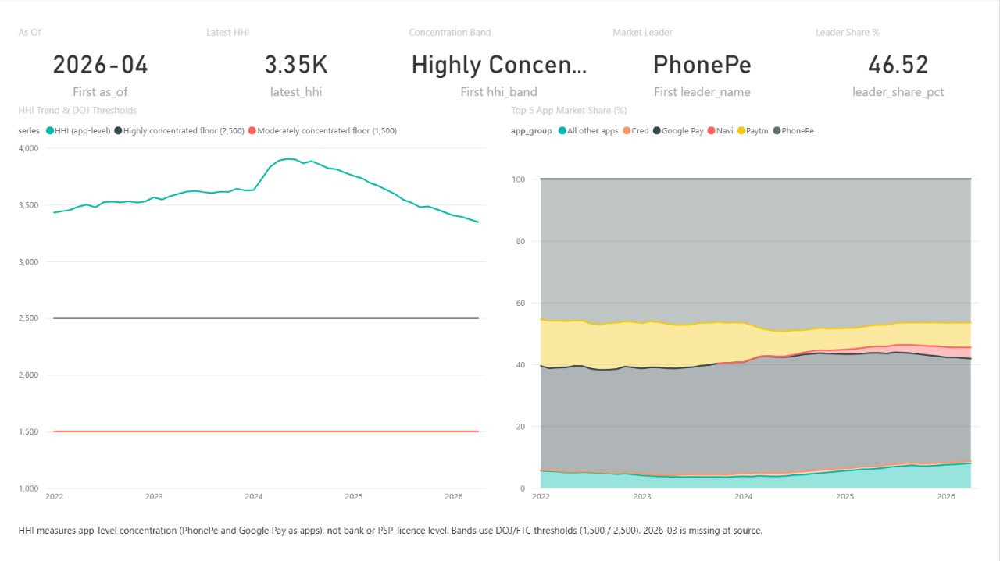
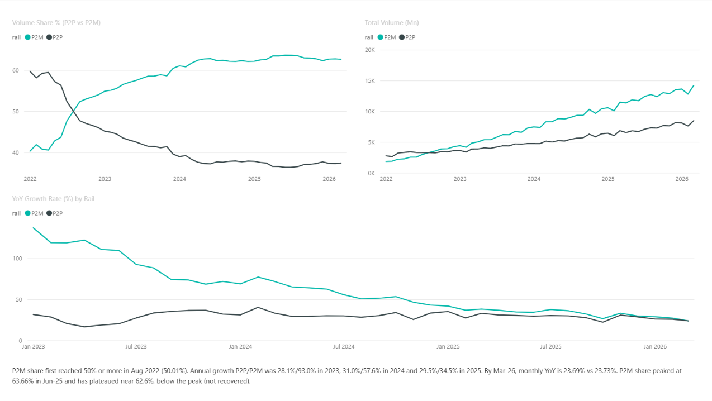
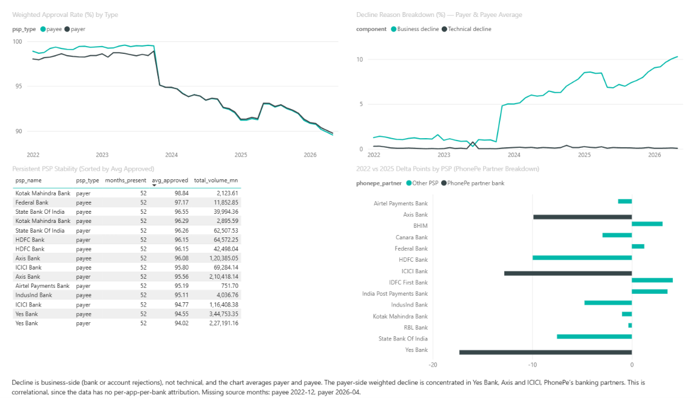
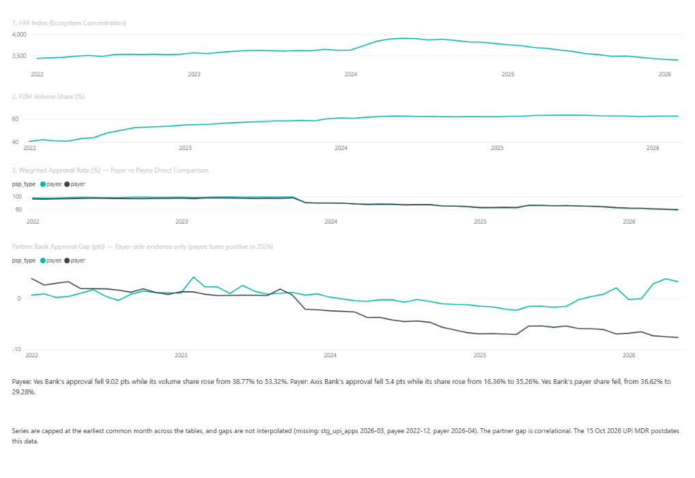

# NPCI UPI Analytics

An end-to-end analytics pipeline over public NPCI UPI ecosystem statistics (Jan 2022 – spring 2026):
Excel extracts → Python ETL → SQLite staging → SQL analysis → four-page Power BI dashboard,
plus a clearly labelled scenario analysis of the proposed P2M merchant discount rate (MDR).

**Tools:** Python (pandas, sqlite3), SQLite, SQL, Power BI.

**Data:** NPCI Ecosystem Statistics (UPI Apps, P2P/P2M, Top-15 PSP sheets). Public data only; no synthetic data.

## Repository structure

The tree below lists the project files and folders in the repository. Git-ignored source extracts and generated
outputs are intentionally not listed.

```text
.
├── .gitignore
├── DECISIONS.md
├── LICENSE
├── README.md
├── docs/
│   └── screenshots/
│       ├── Cross-Cutting_Narrative.png
│       ├── Market_Concentration.png
│       ├── P2PvsP2M.png
│       └── PSP_Reliability.png
├── logs/
│   ├── etl_p2p_p2m.log
│   ├── etl_top15_psp.log
│   └── etl_upi_apps.log
├── mdr/
│   ├── mdr_app_allocation.csv
│   ├── mdr_inputs.csv
│   └── mdr_pool_grid.csv
├── mdr_scenario.py
├── powerbi/
│   ├── UPI_Analytics.pbip
│   ├── UPI_Analytics.Report/
│   │   ├── .platform
│   │   ├── definition.pbir
│   │   └── report.json
│   └── UPI_Analytics.SemanticModel/
│       ├── .platform
│       ├── definition.pbism
│       ├── diagramLayout.json
│       └── model.bim
├── powerbi_build.py
├── scripts/
│   ├── etl_p2p_p2m.py
│   ├── etl_top15_psp.py
│   ├── etl_upi_apps.py
│   └── sanityCheck.py
├── sql/
│   ├── HHImonthly.sql
│   ├── cross_cutting.sql
│   ├── p2p_p2mGrowth.sql
│   ├── payee_decline_decomposition.sql
│   ├── psp_reliability.sql
│   ├── sanityCheck.sql
│   └── qualityAnalysis/
│       ├── investigation.sql
│       ├── phonepe_partner_approval_slice.sql
│       ├── unified_monthly_metrics.sql
│       └── results/
│           └── sanity_results_*.md
└── staging/
    └── npci_upi.db
```

## Questions answered

1. **Market concentration:** which UPI apps dominate volume, and how has app-level concentration (HHI) moved?
2. **P2M vs P2P:** is merchant payment volume outpacing peer transfers?

A third strand grew out of the first two (PSP approval-rate reliability), and an extension models the
proposed MDR as a scenario. Scope decisions and rejected alternatives (state-level data, fraud detection,
forecasting) are in `DECISIONS.md`.

Findings are tagged **[Finding]** (measured in the data), **[Inference]** (plausible link the data cannot
prove) or **[Scenario]** (driven by stated assumptions).

## Key findings

### Concentration (app level)

- **[Finding]** HHI on app volume share was about 3,431 in Jan 2022, peaked at **3,904.5 in May 2024**,
  and has declined to about 3,350 by Apr 2026. It stays above the 2,500 "highly concentrated" threshold
  (US DOJ/FTC bands) in every month.
- **[Finding]** PhonePe is the #1 app in every month (46.5% share in Apr 2026, Google Pay 33.1%).
- Note: this is **app-level**, not bank- or PSP-licence-level, concentration. "PhonePe dominates" refers to the
  consumer-facing app, not to its sponsor banks.

### P2M vs P2P

- **[Finding]** P2M share first reached 50% in **Aug 2022 (50.01%)**, up from about 40% in Jan 2022,
  and has not fallen below 50% since.
- **[Finding]** P2M share peaked at 63.66% (Jun 2025), fell to 62.32% (Dec 2025) and has plateaued near
  62.6% (62.63% in Mar 2026). That is partial stabilisation below the peak, not a recovery.
- **[Finding]** Growth has converged. Annual P2P/P2M volume growth was 28.1%/93.0% (2023), 31.0%/57.6% (2024)
  and 29.5%/34.5% (2025); by Mar 2026 monthly YoY is 23.69% vs 23.73%. The 2022–23 structural transition
  appears largely complete.

### PSP reliability (top-15 PSPs)

- **[Finding]** Approval rates stepped down at Nov 2023 on both sides, but asymmetrically: on PSPs present in both
  months, payee fell 4.55 pts (98.71 to 94.16) and payer 1.93 pts (98.47 to 96.54).
- **[Finding]** The decline is business-side (bank/account rejections); technical declines stayed low.
  June 2023 payer-side shows a business/technical classification flip that looks like a reporting-template
  artifact, not a reliability event.
- **[Finding]** Payer-side volume-weighted approval fell 6.16 pts (2022 to 2025). Yes Bank, Axis Bank and ICICI Bank
  account for about 84% of it. The same three drive about 90% of the matched payee-side decline (payee weighted fall: 7.08 pts).
- **[Finding]** On the payer side, these three banks went from above the rest-of-field approval average through
  Oct 2023 to below it from Nov 2023, widening to roughly 7.7 pts by May 2026. The payee-side simple-average gap
  does not show this.
- **[Inference]** These three are PhonePe's confirmed banking partners. That is consistent with the dominant app's
  partners driving the decline, but the data has no per-app-per-bank attribution and cannot confirm it.
- **[Finding]** 15 PSPs (8 payee, 7 payer) appear in every available month; Yes Bank has the lowest approval
  of that group on both sides while carrying the largest volume.

## Dashboard

| Page | Focus | Source table |
|---|---|---|
| 1 | Market concentration (HHI, top-5 apps, leader) | `stg_upi_apps` |
| 2 | P2P vs P2M dynamics | `stg_p2p_p2m` |
| 3 | PSP reliability | `stg_top15_psp` |
| 4 | Cross-cutting narrative (aligned panels, partner-bank gap) | all three |









## Data and pipeline

```text
raw/*.xlsx  →  scripts/etl_*.py  →  staging/npci_upi.db  →  sql/*.sql  →  powerbi_build.py  →  Power BI
                                      │
                             scripts/sanityCheck.py (18 checks)
```

- **ETL:** `scripts/etl_upi_apps.py`, `scripts/etl_p2p_p2m.py`, `scripts/etl_top15_psp.py`. Files are named
  `YYYY_MM.xlsx` because the sheets carry no date column; a bad name fails loudly. A year/month guard makes reruns idempotent.
- **Schema variants:** the Top-15 files use three column layouts, handled by fallback column sets.
- **Entity normalisation:** PSP and app names are case-folded and mapped through explicit, documented overrides
  (corporate lineage: Slice/NESFB, BHIM/NBSL, IDFC First; app naming variants: Paytm, Bajaj Finserv, PhonePe).
- **Validation:** `scripts/sanityCheck.py` runs 18 regression guards (gaps, duplicates, percent sums, name leakage,
  header leaks, BD/TD anomaly detector) and writes a markdown report. Documented exceptions are carved out;
  anything undocumented fails.
- **Coverage:** Jan 2022 to spring 2026; the three tables end on different months, so cross-table analysis
  caps at the earliest common month. Missing source months: UPI Apps 2026-03; Top-15 payee 2022-12 and payer
  2026-04. Gaps are shown as breaks, never interpolated.

## Data quality incidents

All incidents below were caught by validation and are documented in `DECISIONS.md`.

| Date | Incident | Detection | Resolution |
|---|---|---|---|
| 07-07-2026 | 2024_06 file saved twice as 2024_07 (P2P/P2M) | identical consecutive volumes | file replaced, month reloaded |
| 10-07-2026 | 2024_03 file was February's (UPI Apps) | HHI step of exactly 0.00 | file replaced; HHI 3,732 to 3,833 |
| 10-07-2026 | header row leaked into 2022-04 | null-volume scan | row deleted; permanent guard added |
| 12-07-2026 | P2M crossover logged as Sep 2022 | log rounded 50.01% to "50.0%" | corrected to Aug 2022; rule: re-verify log figures against the DB |
| 12-07-2026 | percent scaling bug (310 rows over 100%) | approval + BD + TD sum check | scaling keyed to presence of "%" |
| 12-07-2026 | 24 PSPs with multiple spellings | name-mismatch investigation | `.title()` plus explicit overrides |
| 13-07-2026 | NESFB/Slice, NBSL/BHIM, IDFC naming | churn check | entity-lineage overrides |
| 14-07-2026 | "Indian Bank" row was IndusInd in the source | override-collision guard | one-row correction |
| 15-07-2026 | "duplicate" app rows were naming variants | re-examination | overrides plus merge |
| 01-11-2026 | dashboard decline chart summed payer and payee (about 2x) | compared with documented figures | averaged; rule: reconcile every chart against a documented figure |

## MDR scenario analysis (extension)

**This is a scenario, not a measured result.** NPCI's UPI and Services Steering Committee set a 0.4% MDR on select
P2M transactions above Rs 2,000 (capped at Rs 300 for transactions of Rs 75,000 and above; P2P stays free).
It was due on 15 Oct 2026; on 13 Oct NPCI deferred it to "immediately post Diwali" on a date to be notified.
The data therefore holds no post-policy month, and a festive-season confound would mask any early effect.

`mdr_scenario.py` builds a parametric what-if from the trailing 12 months (Apr 2025 – Mar 2026):

| Quantity | Value |
|---|---|
| Annual P2M value | Rs 90.9 lakh crore (9,093,029 cr) |
| Average P2M ticket | Rs 597 |
| Floor on share of value above Rs 2,000 (p) | 16.8% (derived, assuming the reported 95%-of-volume figure) |
| Notional annual pool, across the grid | Rs 4,874 cr to Rs 29,098 cr |
| Mid case, as % of total P2M value | 0.187% (vs the 0.4% headline) |
| App-level HHI, value vs volume basis | 3,719 vs 3,503 |

**[Scenario]** The pool is highly sensitive to p, for which no public value-band data exists, so results are a band.
The effective take rate is well below 0.4% because of the threshold, the cap and the assumptions. App shares use total
UPI value (P2P plus P2M) because the data has no P2M-only split. The 40/30/30 issuer/app/acquirer split and the
sector rates remain unverified and are flagged in `mdr/mdr_inputs.csv`.

## What this analysis can and cannot say

- It can describe app-level concentration, the P2P/P2M transition, and which PSPs' approval rates moved when.
- It cannot attribute any PSP's volume or approval to a specific app (no per-app-per-bank data).
- It cannot measure MDR impact, and it makes no forecast.
- Dominant-app commentary on monetisation is conditional: current P2M MDR is zero by mandate, so volume
  concentration is not profit concentration.
- Approval-rate declines are bank-side declines, not evidence of technical infrastructure failure.

## Reproduce

Run these commands from the repository root. Raw NPCI files are not redistributed; download them from NPCI
Ecosystem Statistics and name them `YYYY_MM.xlsx` under `raw/upi_apps/`, `raw/p2p_p2m/`,
`raw/top15_psp/payer/` and `raw/top15_psp/payee/`.

```bash
python scripts/etl_upi_apps.py
python scripts/etl_p2p_p2m.py
python scripts/etl_top15_psp.py
python scripts/sanityCheck.py staging/npci_upi.db sql/qualityAnalysis/results  # expect 18 pass, 0 fail
python powerbi_build.py staging/npci_upi.db powerbi  # regenerates the 11 CSVs and .pbip project
python mdr_scenario.py staging/npci_upi.db mdr
```

Power BI export CSVs are git-ignored; `powerbi_build.py` rebuilds them. The scenario output CSVs in `mdr/` are tracked.

## Limitations and next steps

- Three source months are missing and not imputed; the series end on different months.
- One merged-entity override (IDFC Bank to IDFC First Bank) is medium confidence; see `DECISIONS.md`.
- Next: obtain a ticket-size or value-band source for P2M to replace the assumed p range, and re-run the
  scenario once NPCI notifies the MDR start date and publishes post-policy months.

`DECISIONS.md` is the full audit trail: every non-obvious choice, the evidence, and what was superseded.

## License

This project is licensed under the [MIT License](./LICENSE). Copyright (c) 2026 Lalit Negi.
